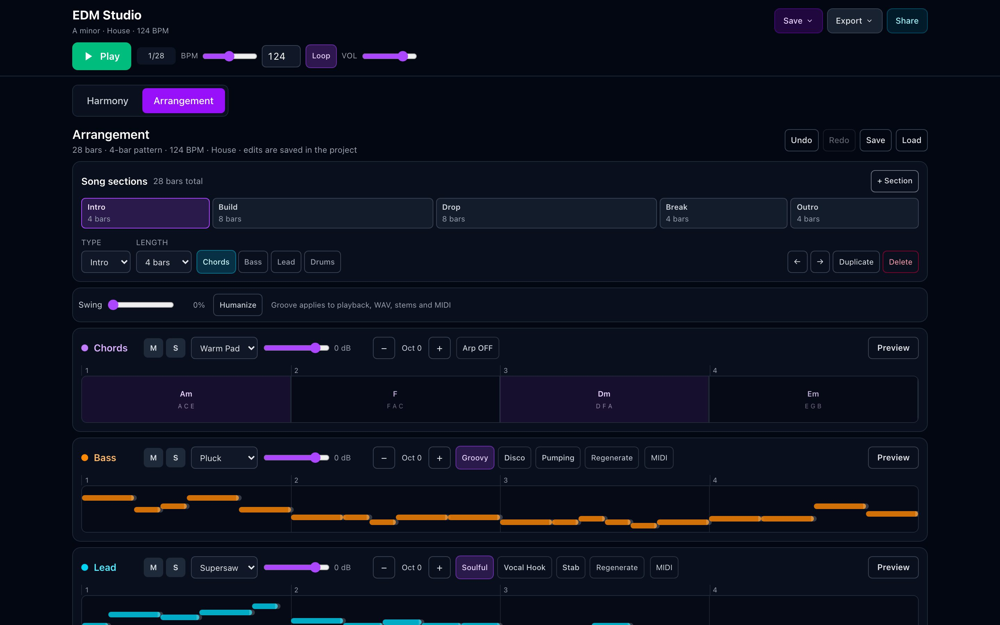
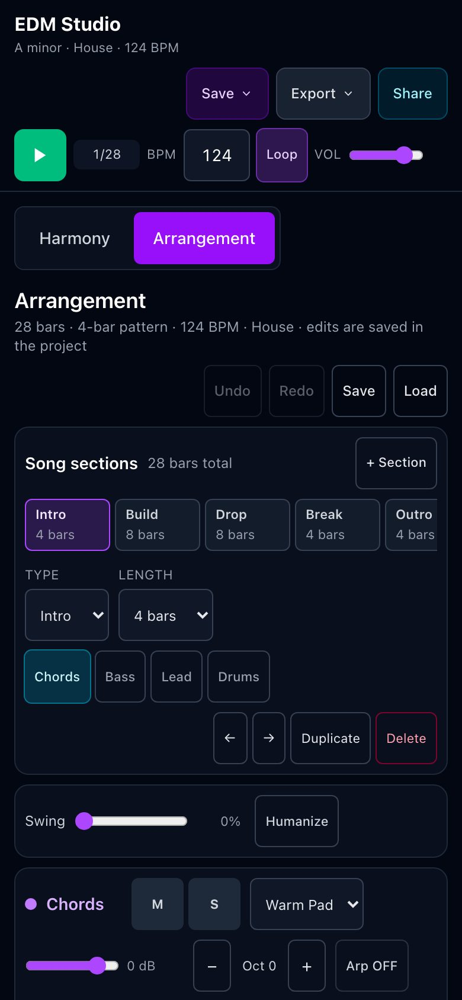

# EDM Studio — chord, bass, lead & drum generator

A fully offline Progressive Web App (PWA) for turning an EDM idea into a playable sketch: pick a genre and a key, audition genre-specific progressions, arrange bass/lead/drums, then export MIDI or WAV to your DAW.

**Live app:** <https://the-trvlr.github.io/EDM-Chords-and-Melodies-Generator/>
**Roadmap:** [`docs/PLAN-UIUX-2026.md`](docs/PLAN-UIUX-2026.md) · **Changelog:** [`CHANGELOG.md`](CHANGELOG.md)



---

## What's new in 0.6

- **Song sections**: Intro/Build/Drop/Break/Outro blocks with per-section track gating, reordering and duplication.
- **Piano-roll editing** for bass and lead, plus swing and humanize that also affect WAV, stems and MIDI.
- **Per-track octave transposition** for chords, bass and lead.
- **Stems export**: four separate WAVs packed into a zip.
- **Audio fixes**: master limiter, supersaw voice budget, per-rhythm ADSR so tails do not collide, genre-accurate drum patterns.
- **40 unit tests** wired into CI.

See [`CHANGELOG.md`](CHANGELOG.md) for the complete list.

## Features

### Harmony

- **8 genres:** House, Techno, Trance, Drum & Bass, Dubstep, Future Bass, Progressive House, Hardstyle.
- 5 curated progression templates per genre, with genre defaults for BPM, scale, rhythm and synth.
- **All 12 keys and 9 scales/modes** (major, minor, Dorian, Phrygian, Lydian, Mixolydian, Locrian, harmonic/melodic minor), spelled conventionally (flats for flat keys).
- **4 chord complexity levels:** simple triads, 7ths, 9ths, jazzy voicings.
- **Chord editing:** add/remove, drag to reorder, inversions, auto voice-leading, undo/redo.
- **Visual feedback:** active chord highlighting, piano keyboard, VexFlow staff notation.
- Chord edits **transpose with the key** and are kept when you change genre.

### Arrangement

- **Four tracks:** Chords (block or arpeggiated), Bass, Lead, Drums.
- **Song sections** with per-section track gating and song-length playback.
- **Piano-roll editing** for bass/lead (draw, move, resize, delete) and per-track octave shift.
- **Swing and humanize** applied consistently to playback and all exports.
- Per-track instrument, volume, mute and solo; solo preview per track.
- **Arpeggiator:** up/down/up-down/random, 1/8 or 1/16, 1–3 octaves, gate.
- **Bass and lead generators** with genre-specific styles, seeded and regenerable.
- **Drum machine:** genre-accurate one-bar patterns (two-step DnB, half-time dubstep, trap hats, four-on-the-floor house), 5 kits, click-to-edit steps.
- Piano-roll lanes with bar ruler, grid and synced playhead.

### Transport & export

- Sticky transport: play/stop, bar counter, BPM (slider + input), loop, master volume.
- `Cmd/Ctrl+Space`/`Space` play-stop, `Cmd/Ctrl+Z`/`Shift+Z` undo-redo, `Cmd/Ctrl+S` save, `Cmd/Ctrl+O` open.
- **MIDI:** chord progression, full arrangement, and per-track files (bass, lead, drums on GM channel 10).
- **WAV mix** and **stems** (4-track zip) rendered offline with the same instruments, kit and effects as playback.
- **Project files** (`.json`) with harmony + arrangement; browser-stored arrangement snapshots.
- **Share links** that restore the whole project, including custom chords and mixer.

### Offline PWA

- Installable on desktop, Android and iOS.
- Works fully offline after the first load; service worker precaches the app.
- No accounts, no network calls, no audio files.

## Screenshots

| Desktop | Mobile |
|---|---|
|  |  |

## Using the app offline

### Option 1 — hosted version (recommended)

1. Open <https://the-trvlr.github.io/EDM-Chords-and-Melodies-Generator/>.
2. Install it as a PWA: Chrome/Edge — install icon in the address bar; Android — “Add to Home screen”; iOS Safari — Share → “Add to Home Screen”.
3. The app then opens offline at any time.

### Option 2 — run from source

```bash
git clone https://github.com/the-trvlr/EDM-Chords-and-Melodies-Generator.git
cd EDM-Chords-and-Melodies-Generator
npm install
npm run dev        # http://localhost:5173
npm run build      # production build with service worker
npm run preview    # http://localhost:4173
```

The `dist/` folder is a fully static site and can be hosted anywhere.

## Tech stack

| Layer | Technology |
|---|---|
| UI | React 19 + TypeScript |
| Build | Vite 8 |
| Styling | Tailwind CSS 4 |
| Audio | Tone.js 15 (Web Audio API) |
| Notation | VexFlow 5 (lazy-loaded) |
| MIDI | midi-writer-js 3 |
| PWA | vite-plugin-pwa + Workbox |
| Tests | Vitest |

## Project structure

```
src/
├── App.tsx                    # studio shell: state, transport, project/share, shortcuts
├── types.ts                   # project, melody and mixer types
├── hooks/
│   └── useToast.ts            # toast context + hook
├── components/
│   ├── TransportBar.tsx       # unified transport
│   ├── MelodyStudio.tsx       # arranger (sections, tracks, mixer, export, dialogs)
│   ├── SectionsTimeline.tsx   # song structure editor
│   ├── lanes.tsx              # chord lane, editable piano roll, drum grid
│   ├── Menu.tsx, Modal.tsx, Toast.tsx, Skeleton.tsx, ErrorBoundary.tsx
│   ├── ChordDisplay.tsx, ChordPalette.tsx, PianoKeyboard.tsx, StaffNotation.tsx
│   ├── KeySelector.tsx, GenreSelector.tsx, ProgressionSelector.tsx,
│   │   RhythmSelector.tsx, SynthSelector.tsx
├── data/
│   ├── genres.ts              # genres, progressions, rhythms
│   └── drumKits.ts
└── utils/
    ├── schedule.ts            # single event schedule for live/WAV/MIDI (sections, octaves, swing)
    ├── audioProfiles.ts       # envelopes, voice budgets, per-rhythm ADSR
    ├── audioEngine.ts         # chord playback
    ├── mixer.ts               # multi-track playback + offline WAV render
    ├── musicTheory.ts         # scales, chords, inversions, voice leading
    ├── melodyGenerator.ts     # seeded bass/lead generation
    ├── arpeggiator.ts         # deterministic arpeggios
    ├── drumGenerator.ts       # genre drum patterns
    ├── midiExport.ts          # MIDI writers
    ├── share.ts               # share-link codec + validation
    ├── sanitize.ts            # validation for files, links and storage
    ├── persistence.ts         # localStorage, project files, arrangements
    └── __tests__/             # Vitest unit tests
```

## Scripts

| Command | Description |
|---|---|
| `npm run dev` | Development server with HMR |
| `npm run build` | Type-check and build for production |
| `npm run preview` | Preview the production build |
| `npm run lint` | ESLint |
| `npm test` | Unit tests (Vitest) |
| `npm run test:watch` | Unit tests in watch mode |

## Testing

- Unit tests cover the event schedule (chord holds, arp replacement, drum repetition), drum generation, the share codec (including legacy links), project files and music-theory helpers.
- CI runs lint → type-check → tests → build → deploy to GitHub Pages.

## Browser support

Chrome/Edge 80+, Firefox 76+, Safari 14.1+, Chrome for Android, Safari iOS 14.5+. Web Audio requires one user gesture, hence the “Start making music” screen.

## Roadmap

The next milestones are described in [`docs/PLAN-UIUX-2026.md`](docs/PLAN-UIUX-2026.md): section timeline (intro/build/drop), piano-roll editing with swing/humanize, stems export, project library + share 2.0, i18n.

## License

MIT — see [`LICENSE`](LICENSE).
