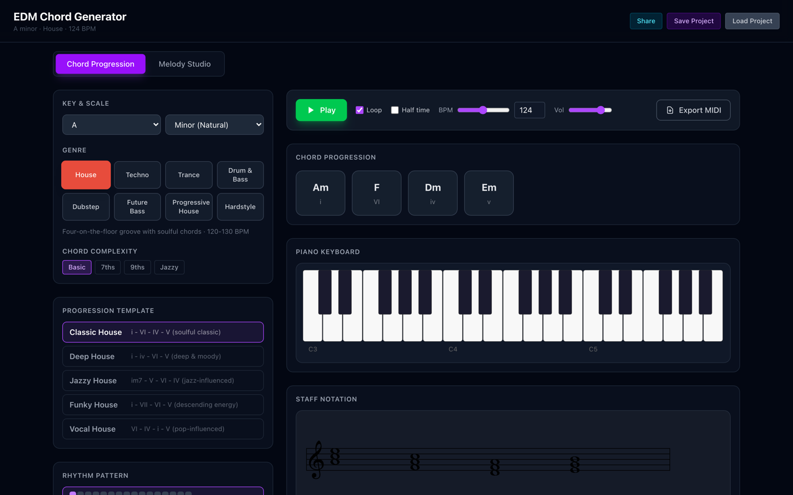
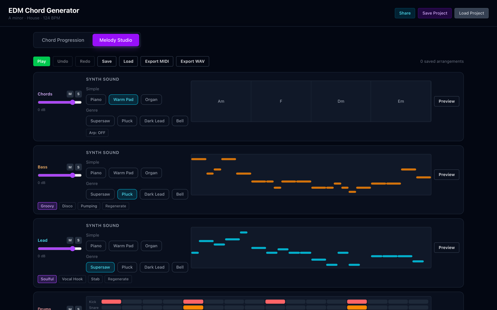
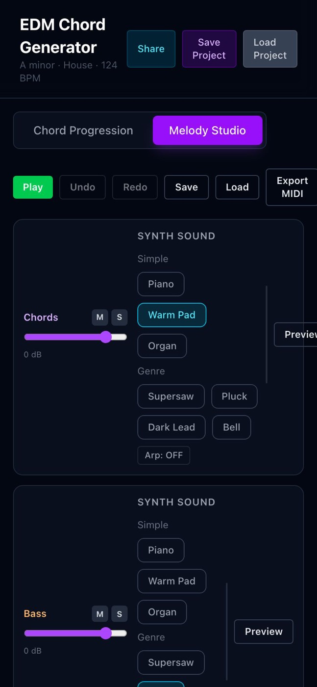
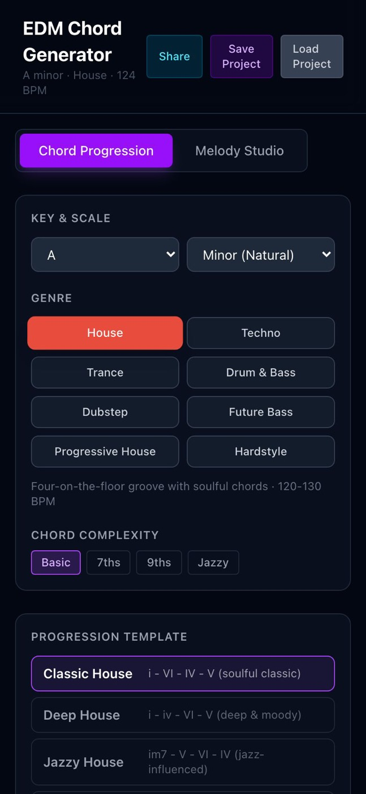

# EDM Chords & Melodies Generator — аудит и план доработки (v2)

**Дата:** 3 ноября 2026
**Объект:** `EDM_Chords_PWA/EDM-Chords-and-Melodies-Generator` (локально) + [GitHub](https://github.com/the-trvlr/EDM-Chords-and-Melodies-Generator) + [live-версия на GitHub Pages](https://the-trvlr.github.io/EDM-Chords-and-Melodies-Generator/)
**Статус кода:** `main` = `bd4e456` (PR #21), CI зелёный, Pages обновлён
**Метод:** чтение исходников, сборка и замер бандла, реальные скриншоты через headless Chrome на 1440 / 834 / 390 px, замер контраста и тач-таргетов, проверка GitHub API (CI, issues, ветки)

---

## Статус реализации (v0.10, 4 ноября 2026)

В v0.10.0 закрыт velocity-редактор из F2: полоса velocity под piano roll (drag/↑↓), velocity в плейбеке, WAV, stems, MIDI и share; акценты по умолчанию.

## Статус реализации (v0.9, 4 ноября 2026)

В v0.9.0 селектор диапазона переработан: теперь он задаёт **ширину** (1/2/3 октавы), а не базовую октаву; база фиксирована (бас C2, лид C5), регистр по-прежнему сдвигается октавным степпером. Ширина сохраняется в проекте/share.

## Статус реализации (v0.8.1, 4 ноября 2026)

v0.8.1: удаление ноты одним кликом в piano roll (drag — перемещение, правый край — длина), переименование сохранённых аранжировок.

## Статус реализации (v0.8, 4 ноября 2026)

В v0.8.0: генераторы баса и лида ограничены одной октавой (скачки ≤7/≤9 полутонов, аккордовые тоны от корня, а не от инверсии), добавлен селектор диапазона `C1–B1 … C7–B7` с сохранением в проекте и share.

## Статус реализации (v0.7, 4 ноября 2026)

В v0.7.0 дополнительно закрыты: Preview (одна прогрессия, принудительный solo, восстановление микшера), разрыв такта в chord-MIDI (абсолютные тики), GM-ноты барабанов и отдельные MIDI-дорожки Kick/Snare/Clap/Hat, маркеры секций, дублирование проекта. Осталось из 0.7: velocity-редактор, метроном/count-in, RU/EN.

## Статус реализации (v0.6, 3 ноября 2026)

Спринты 3–4 выполнены в **v0.6.0** (см. [`CHANGELOG.md`](../CHANGELOG.md)):

| Фича | Статус | Что сделано |
|---|---|---|
| F1 секции трека | ✅ | Intro/Build/Drop/Break/Outro, гейтинг дорожек, длина песни, повтор прогрессии, экспорт с учётом структуры |
| F2 piano-roll | ✅ (базово) | добавление/перемещение/ресайз/удаление нот, сброс к генерации; velocity-редактор — 0.7 |
| F3 генератор 2.0 | ◐ | per-rhythm ADSR, октавы, swing/humanize; мотивы/контр-ответ — 0.7 |
| F4 экспорт 2.0 | ✅ | stems zip, MIDI по общему расписанию, GM-канал 10; markers — 0.7 |
| F5 библиотека/share | ◐ | полный share (секции, октавы, ноты, groove), автосохранение сессии; rename/duplicate — 0.7 |
| F6 гармония 2.0 | ⏳ | 0.7 |
| F7 практика | ◐ | swing/humanize; метроном/count-in/MIDI-in — 0.7 |
| F8 i18n/PWA | ◐ | PWA-полировка есть; RU/EN — 0.7 |

Дополнительно к плану: мастер-лимитер, бюджет голосов, переработанный supersaw, жанроспецифичные барабаны с тестами, транспозиция дорожек по октавам.

## Статус реализации (v0.4, 3 ноября 2026)

Спринты 1–2 выполнены, релиз **v0.4.0** (см. [`CHANGELOG.md`](../CHANGELOG.md)):

| Эпик | Статус | Что сделано |
|---|---|---|
| P0-дефекты B1–B8 | ✅ | мобильный Arrangement, WYSIWYG-экспорт (арп/кит/реверб/мастер), барабаны 16 шагов, единый `Space`, undo первого действия, загрузка аранжировки с контекстом, share 1:1 |
| U1 мобильный Arrangement | ✅ | лейны 340 px при 390 px viewport, нет горизонтального скролла, 4 дорожки в 1440×900 |
| U2 единый транспорт | ✅ | sticky-транспорт, BPM/Loop/Vol, воспроизведение не прерывается при смене вкладки, один обработчик клавиш |
| U3 компактные треки | ✅ | synth-`select` вместо 21 кнопки, bar ruler, сетка тактов, пиано-ролл лейны |
| U4 дизайн-система и a11y | ✅ (кроме i18n) | контраст, 44 px на мобильном, `aria-*`, модалки с Esc/focus-trap, focus-visible, reduced motion |
| U5 сохранение/экспорт | ✅ | единые меню, тосты, per-track MIDI, WAV, project JSON, валидация |
| U6 онбординг | ◐ | пустые состояния и подсказки есть; тур и шпаргалка шорткатов — v0.5 |
| T1 lazy VexFlow | ✅ | initial JS ≈168 КБ gzip вместо ≈843 КБ; VexFlow — 387 КБ gzip (сборка `vexflow/bravura`) и только при появлении стана |
| T3 тесты | ◐ | 27 unit-тестов в CI; Playwright-smoke — следующий спринт |
| T4 схемы/валидация | ✅ | `sanitize.ts` + версия share-формата (v2) с обратной совместимостью |
| T5 единый планировщик | ✅ | `schedule.ts` питает live, WAV и MIDI |
| T6 надёжность | ✅ | error boundary, тосты, обработка ошибок аудио/WAV |
| T7 PWA/перф | ◐ | манифест, apple-мета, safe-area, кэш; update-тост и size-limit в CI — далее |

Осталось из плана: VexFlow всё ещё грузится на десктопе, когда стан появляется в зоне видимости; 16-шаговая сетка барабанов сознательно меньше 44 px; E2E-тесты; i18n; секции трека, piano-roll и stems — v0.5–v0.6.

Ниже — исходный аудит и план, сохранённый как есть (скриншоты в `uiux-audit/` — состояние «до»).

---

## 0. Резюме (TL;DR)

**Что уже хорошо.** Это не «сырой прототип»: 8 жанров, 5 прогрессий на жанр, 9 ладов, 4 уровня сложности аккордов, инверсии и авто-голосоведение, арпеджиатор, генератор барабанов, 7 синтов, мультитрек-движок (Chords/Bass/Lead/Drums), экспорт MIDI/WAV, PWA с офлайном. Сборка 443 мс, `lint` и `tsc` чистые, CI собирает и деплоит, live-версия побайтово соответствует `main` (одинаковые хэши чанков). Это крепкая генеративная «начинка».

**Что мешает продукту.**

1. **Мобильный Arranger физически сломан.** При ширине 390 px дорожки мелодий сжимаются до **2 px**, страница уезжает в горизонтальный скролл (560 px), кнопки `Export WAV`/`Preview` уходят за экран, каждая дорожка занимает ~600 px по высоте. Скриншоты ниже.
2. **Экспорт не совпадает с тем, что слышно.** WAV игнорирует арпеджиатор, всегда рендерит «Acoustic» барабаны и другой реверб (`Freeverb` вместо `Reverb`); предпросмотр барабанов тоже всегда «Acoustic». Это подрывает доверие к инструменту сильнее, чем любой визуальный дефект.
3. **Нет единого транспорта.** BPM, Loop, мастер-громкость и Play живут в разных вкладках; переключение вкладки останавливает воспроизведение. В Arranger нельзя менять темп, не выходя из него.
4. **Три параллельные системы сохранения** (JSON-файл, localStorage-«аранжировки», ссылка-пресет) с разной полнотой. Ссылка теряет ручные правки прогрессии, инверсии и микшер; загрузка аранжировки игнорирует тональность/жанр/BPM.
5. **Управление аккордами неочевидно:** удаление — только по ховеру (на тач недоступно), инверсии — три кнопки `0 1 2` на каждый аккорд, Undo не отменяет первое действие.
6. **Доступность и контраст ниже нормы:** 53 из 73 интерактивных элементов меньше 44 px, у ползунков BPM/Vol и громкостей дорожек нет доступных имён, контраст `text-gray-600` на фоне `#030712` — **2.66:1** (нужно 4.5:1), модалки без `role="dialog"`/Esc/focus-trap.
7. **Первый экран грузит 1.69 МБ JS, из них VexFlow — 688 КБ gzip.** Он нужен только для нотного стана, но грузится всегда и блокирует интерактивность.

**Предлагаемая стратегия.** Не «переписать», а **стабилизировать → уплотнить → углубить**:

- **Спринт 1 (2 недели):** P0-дефекты, мобильный Arrangement, a11y-минимум. Релиз **v0.3 «Mobile-ready»**.
- **Спринт 2 (2 недели):** единый транспорт, компактные треки, дизайн-система, WYSIWYG-экспорт, ленивый VexFlow. Релиз **v0.4**.
- **Спринт 3 (2 недели):** секции трека (Intro/Build/Drop), piano-roll редактор, swing/humanize. Релиз **v0.5**.
- **Спринт 4 (2 недели):** stems-экспорт, библиотека проектов, Share 2.0, i18n RU/EN. Релиз **v0.6**.

Итого ~**39 человеко-дней** до v0.6, из них ~12 — исправления и UX-консолидация.

---

## 1. Что именно проверено

| Проверка | Как | Результат |
|---|---|---|
| Локальный репозиторий | git, чтение всех 41 файла `src/` | ветка `feature/workflow-ux` @ `112ab2f`, дерево чистое, всё влито в `main` |
| GitHub | `api.github.com`: repo, runs, issues, branches | 0 открытых issues/PR, 40 коммитов, 18 веток (много устаревших), 0 тэгов/релизов, **нет файла LICENSE** |
| CI/CD | Actions API | последний run `bd4e456` — success (lint → tsc → build → deploy) |
| Live | GET Pages + сравнение хэшей ассетов | 200 OK, ассеты совпадают с локальной сборкой `main` |
| Сборка | `npm run build`, `npm run lint`, `npx tsc -b` | успешно; lint/tsc без ошибок; сборка 443 мс |
| Бандл | вывод Vite | `index` 67 КБ gz, `melody-studio` 85 КБ gz, `vexflow` **688 КБ gz** (1.12 МБ raw); precache 1.69 МБ |
| UI — десктоп | Chrome headless 1440×900 + CDP | 4 скриншота, оба экрана |
| UI — планшет/мобайл | 834×1112, 390×844, эмуляция touch | горизонтальный overflow, лейны 2 px, обрезанные кнопки |
| A11y | DOM-аудит в браузере | 53/73 таргета < 44 px, 5 ползунков без имени, 0 `aria-live`, 0 `role=dialog`, 0 skip-link |
| Контраст | пересчёт OKLCH → sRGB → WCAG | `gray-600` на `gray-950` = **2.66:1**, `gray-500` на `gray-900` = **3.67:1**, `gray-500` на `gray-800` = **3.03:1** |

---

## 2. Состояние: локально vs GitHub

```
локально:  /Users/borisulzibat/Dev/EDM_Chords_PWA/EDM-Chords-and-Melodies-Generator
           branch feature/workflow-ux @ 112ab2f  (1 коммит позади main, содержимое влито)
GitHub:    the-trvlr/EDM-Chords-and-Melodies-Generator  main @ bd4e456 (merge PR #21)
live:      the-trvlr.github.io/EDM-Chords-and-Melodies-Generator  == main
```

| Параметр | Значение | Комментарий |
|---|---|---|
| Синхронизация | локальный HEAD = родитель `main`, рабочее дерево чистое | ветку можно удалить/переключить на `main` |
| Тесты | **0** | ни unit, ни e2e; регрессии ловятся вручную (в истории 4 подряд «fix»-коммита) |
| Версия | `package.json` 0.0.0 | нет релизов и тэгов, нет CHANGELOG |
| Лицензия | README заявляет MIT, файла `LICENSE` нет | юридическая неопределённость для публичного репо |
| Документация | `README.md` (8 КБ), `PLAN.md` (10 КБ) | `PLAN.md` помечает Phase 3 завершённой и одновременно «code-splitting не сделан» — хотя `manualChunks` есть; это не code-splitting, а лишь разбиение |
| Ветки | 18 (локальные + remote `devin/*`, `feature/*`) | устаревшие ветки шумят в PR-списке |
| Issues | 0 | бэклог живёт только в `PLAN.md` |
| Зависимости | React 19.2, Vite 8, Tailwind 4, Tone 15, VexFlow 5, midi-writer-js 3 | актуальные; Node 24 в CI и локально |
| Размер репо | 281 КБ | компактно |

**Вывод по «локально vs GitHub»:** расхождений по коду нет, деплой живой и свежий. Проблема не в синхронизации, а в **отсутствии инженерной страховки** (тесты/лицензия/релизы) и в том, что `PLAN.md` описывает намерения, а не факты.

---

## 3. Аудит UI/UX

### 3.1 Информационная архитектура и путь пользователя

Заявленная модель из `PLAN.md` — воронка «гармония → аранжировка → DAW». Фактически она разорвана:

```
[Chord Progression]  ──(переключение вкладки ОСТАНАВЛИВАЕТ звук)──►  [Melody Studio]
   Play/BPM/Loop/Vol/Export MIDI                                     Play/Undo/Redo/Save/Load/Export MIDI/WAV
   Key/Genre/Progression/Rhythm/Synth                                Synth×4 (по 7 кнопок), Mixer, Styles
```

- Общие для обоих экранов сущности (темп, loop, громкость, play) **продублированы**, но не синхронизированы по месту: в Arranger нет BPM и Loop, зато есть свой Play.
- Сохранение: `Share` / `Save Project` / `Load Project` в шапке (JSON-файл) **и** `Save`/`Load` в Arranger (localStorage-аранжировки) — пользователь не понимает, чем они отличаются, и что именно сохраняется.
- Экспорт: `Export MIDI` есть на обоих экранах с разным смыслом (прогрессия vs мультитрек), `Export WAV` — только в Arranger. Нет единого «Export…» с выбором.

**Следствие:** чтобы изменить темп и послушать результат, нужно переключать вкладку; переключение останавливает воспроизведение; правки в Arranger не попадают в шапку-сохранение.

### 3.2 Экран «Chord Progression»



**Работает хорошо:** сетка 1/3 + 2/3, читаемая типографика, жанровые цвета, прогрессия и римские цифры, клавиатура и стан, drag-to-reorder, инверсии, авто-голосоведение, история.

**Проблемы:**

| # | Проблема | Где | Эффект |
|---|---|---|---|
| C1 | Удаление аккорда только по ховеру (`group-hover` показывает `✕`) | `ChordPalette.tsx:110-120` | на тач-устройствах удаление недоступно; на десктопе не discoverable |
| C2 | Один клик по аккорду в секвенции **удаляет** его — рядом с drag-зоной | `ChordPalette.tsx:104-121` | случайные удаления; нет подтверждения и нет undo первого действия |
| C3 | Инверсии — три кнопки `0/1/2` на каждый аккорд (12–15 кнопок в ряду) | `ChordPalette.tsx:122-135` | визуальный шум, таргеты 20×20 px |
| C4 | Undo/Redo не отменяют первое действие: история стартует с `[]`, `index = -1`, после первого изменения `index = 0` → `canUndo = false` | `App.tsx:65-66, 248-253, 382-387` | «Undo не работает» в первый и самый важный момент |
| C5 | Смена жанра/тональности/сложности **молча** сбрасывает `customProgression` | `App.tsx:233-239, 269-278` | потеря ручных правок без предупреждения |
| C6 | Сложность аккордов (`basic/7ths/9ths/jazzy`) спрятана в блоке «Key & Scale» | `App.tsx:526-544` | ключевой параметр звучания выглядит второстепенным |
| C7 | Нотный стан фиксированной ширины 600–680 px, уезжает в горизонтальный скролл | `StaffNotation.tsx:56-60` | на мобильном приходится скроллить, чтобы увидеть 4 аккорда |
| C8 | Пиано-клавиатура пуста, пока не выбран аккорд; нет подсказки-пустого состояния | `PianoKeyboard.tsx:28-40`, `App.tsx:600` | выглядит «сломанной» на первом экране |

### 3.3 Экран «Melody Studio» (Arranger)



**Работает хорошо:** единый движок, синхронный playhead, per-track Mute/Solo/Volume, стили баса/лида, арп, барабаны с редактируемой сеткой, WAV/MIDI.

**Проблемы:**

| # | Проблема | Где | Эффект |
|---|---|---|---|
| A1 | Каждая из трёх мелодийных дорожек содержит **полный блок «SYNTH SOUND» из 7 кнопок** (21 кнопка + селект кита) | `MelodyStudio.tsx:651, 742, 761`; `SynthSelector.tsx:20-54` | ~600 px высоты на дорожку, Arranger не влезает в экран, сравнение треков невозможно |
| A2 | Дорожки не выровнены: лейн начинается после блока синтов, `pl-[140px]` для вторичных контролов | `MelodyStudio.tsx:601, 680, 844` | «прыгающие» отступы, разная ширина лейнов |
| A3 | Лейны мелодий — «плавающие» полоски без сетки, бар-линий, подписей нот/октав, без выделения тактов | `MelodyStudio.tsx:57-93` | невозможно понять ритм и высоту; выглядит как декорация |
| A4 | Барабаны: сетка 16 шагов, но `generateDrums` возвращает `bars × 16`, а воспроизведение использует `step % 16` | `drumGenerator.ts:236-300`, `mixer.ts:247`, `MelodyStudio.tsx:788` | вариации 2–4 такта генерируются, но **никогда не звучат**; правки применяются только к первому такту |
| A5 | Mute/Solo — кнопки 20×20 px, состояния только цветом | `MelodyStudio.tsx:605-614` | не попасть пальцем; цветовая слепота |
| A6 | Ползунки громкости без `aria-label`, значение `0 dB` — `text-[10px] text-gray-500` | `MelodyStudio.tsx:617-622` | a11y + нечитаемо |
| A7 | Пресет барабанов `DnB/Dubstep/Future Bass` — фактически four-on-the-floor клоны | `drumGenerator.ts:111-179` | жанровая ценность барабанов близка к нулю |
| A8 | `Preview` барабанов всегда создаёт «Acoustic» кит, игнорируя выбранный | `mixer.ts:318-321` | выбор кита «не работает» |
| A9 | WAV игнорирует арп и кит, реверб другой (`Freeverb` vs `Reverb`), мастер-громкость не применяется | `MelodyStudio.tsx:425-442`, `mixer.ts:428-460` | экспорт ≠ превью |
| A10 | Загрузка аранжировки игнорирует `rootKey`, `scaleType`, `genreId`, `bpm`, номер прогрессии | `MelodyStudio.tsx:294-318` | «сохранил в A-moll, загрузил в C-dur — другая музыка» |
| A11 | Модалки Save/Load без `role="dialog"`, без Esc, без focus-trap, без клика по фону | `MelodyStudio.tsx:516-593` | клавиатура/скринридер не работают |
| A12 | Кнопка Play зелёная, Stop красная — красный обычно означает «запись/удаление» | `MelodyStudio.tsx:464-469` | конфликт семантики с остальным UI |
| A13 | `rendering` блокирует только кнопку WAV; нет прогресса и отмены | `MelodyStudio.tsx:502-508` | на длинной аранжировке «зависло?» |

### 3.4 Мобильный опыт — главный блокер



Замеры при 390×844 (эмуляция touch):

- ширина документа на Arranger — **560 px** при viewport 390 px (горизонтальный скролл всей страницы);
- лейны мелодий — **2 px шириной** (`flex-1` внутри `flex` с несжимаемыми блоками синтов и `Preview`);
- кнопки `Export MIDI` и `Export WAV` уходят за правый край, `Preview` обрезан;
- шапка: `Load Project` переносится и рвётся, таб-бар шире экрана;
- высота одной дорожки ~600 px → Arrangement = ~2600 px скролла без возможности сравнить треки;
- шапка не sticky, транспорт не закреплён — при скролле до барабанов Play недоступен.



На экране Chords мобильный overflow отсутствует (390 px), но нотный стан (680 px) и клавиатура (400 px) живут в горизонтальном скролле; блоки идут в один столбец, и до Play нужно проскроллить весь левый столбец контролов — на 390 px кнопка Play оказывается **ниже** 4 блоков настроек.

### 3.5 Доступность и контраст

| Проверка | Факт | Норма | Итог |
|---|---|---|---|
| Тач-таргеты | 53 из 73 элементов < 44 px (M/S 20 px, инверсии 20 px, шаги барабанов 12 px) | ≥ 44×44 | ✗ |
| Имена ползунков | 2 `<input type=range>` без имени на Chords (BPM, Vol) и 4 на Arrangement (громкости дорожек); BPM-number тоже без метки | обязательны | ✗ |
| Модалки | 0 `role="dialog"`, нет `aria-modal`, нет Esc/focus-trap | WAI-ARIA APG | ✗ |
| Live-регионы | 0 `aria-live` (статус сохранения/копирования/записи WAV) | нужен | ✗ |
| Skip-link / nav | нет | желательно | ✗ |
| Контраст `gray-600` на `gray-950` | **2.66:1** (футер, подсказка «Click to enable audio engine») | ≥ 4.5:1 | ✗ |
| Контраст `gray-500` на `gray-800/900` | **3.03 / 3.67:1** (подписи `0 dB`, описания жанров) | ≥ 4.5:1 | ✗ |
| Контраст `gray-400` на `gray-900` | 6.82:1 | ≥ 4.5:1 | ✓ |
| Фокус | UA-outline `auto 1px rgb(0,95,204)` виден, но не брендирован | видимый | ~ |
| Заголовки | один `h1`, панели без `h2` | иерархия | ~ |
| `prefers-reduced-motion` | не учитывается (`animate-pulse`, `scale-105`, transitions) | уважать | ✗ |

### 3.6 Терминология и микротекст

| Термин | Проблема | Предложение |
|---|---|---|
| «Half time» | код увеличивает длительность аккорда **в 2 раза** (`barsPerChord = 2`), README называет это «Double Time» | «2 такта на аккорд» / «×2 длительность» — без музыкальной двусмысленности |
| «Melody Studio» | внутри уже не только мелодии: арп, барабаны, микшер, экспорт | «Arrangement» или «Studio» |
| «Save Project» / «Save» | два разных сохранения с одинаковым словом | «Save to file…» / «Save arrangement» + иконки, либо единое «Save» с выбором |
| «Preview» | на деле играет дорожку соло | «Solo preview» или иконка ▶ с подписью |
| «Share» | копирует ссылку, но теряет часть состояния | «Copy link» + честный индикатор «в ссылку войдёт: …» |
| «Regenerate» | меняет seed и сбрасывает ручные правки барабанов без предупреждения | «New variation» + undo |
| «Chord Complexity» | basic/7ths/9ths/jazzy — жаргон | «Simple / 7th chords / 9th chords / Jazzy» с подсказкой |

### 3.7 Обратная связь и состояния

- `alert()` для результата копирования ссылки и ошибки загрузки проекта (`App.tsx:186, 219, 222`) — блокирует поток, не стилизуется, не работает в standalone-PWA на iOS как ожидается.
- Нет тостов: «сохранено», «скопировано», «экспортировано», «не удалось».
- Нет глобального error boundary: исключение в VexFlow/Tone валит всё приложение в белый экран (VexFlow обёрнут в `try`, но остальное — нет).
- Нет индикации «изменения не сохранены»; `beforeunload` не предупреждает.
- Пустые состояния: Arranger при пустой прогрессии — одна строка текста (`MelodyStudio.tsx:448-454`), без CTA.

### 3.8 Производительность

| Метрика | Значение | Оценка |
|---|---|---|
| JS первого экрана | **1.69 МБ raw / ~843 КБ gzip** | плохо для PWA «на телефоне» |
| Крупнейший чанк | `vexflow` 1.12 МБ raw / **688 КБ gzip** | нужен только для стана, грузится всегда |
| `manualChunks` | есть, но **не** `import()` → все чанки грузятся на старте | code-splitting фактически не сделан |
| CSS | 31.7 КБ raw / 6.25 КБ gzip | ок |
| Precache | 16 файлов / 1.69 МБ | ок для offline, тяжело для первого визита |
| Сборка | 443 мс | отлично |
| Мемоизация | `useMemo` для мелодий/арпа/барабанов есть; `buildProgression` и `getChordsInKey` пересчитываются на каждый рендер | средне |
| Лишние рестарты | `useEffect` на `synthIds` перезапускает движок посреди игры | слышимый глитч |

---

## 4. Реестр дефектов и техдолга

Приоритеты: **P0** — ломает продукт/доверие, **P1** — заметно мешает, **P2** — качество/долг. Оценка — человеко-дни.

### P0 — исправить в спринте 1

| ID | Дефект | Где | Эффект | Оценка |
|---|---|---|---|---|
| B1 | Мобильный Arranger: лейны 2 px, overflow 560 px, обрезанные кнопки | `MelodyStudio.tsx:601, 651-668, 740-841` | продукт не работает на телефоне | 2 |
| B2 | WAV ≠ превью: нет арпа, всегда Acoustic, другой реверб, нет мастер-громкости | `MelodyStudio.tsx:425-442`, `mixer.ts:428-460` | «экспортировал — не то» | 1.5 |
| B3 | Барабаны: длина `bars×16`, воспроизведение `%16`, UI `slice(0,16)` | `drumGenerator.ts:236`, `mixer.ts:247`, `MelodyStudio.tsx:788` | вариации не звучат, правки теряются | 1 |
| B4 | `Space` обрабатывается двумя слушателями; в Arranger взводит ещё и аккордовый движок | `App.tsx:397-430`, `MelodyStudio.tsx:365-405` | двойной старт, рассинхрон `isPlaying` | 0.5 |
| B5 | Undo не отменяет первое изменение | `App.tsx:65-66, 248-253, 382-387` | «undo сломан» | 0.5 |
| B6 | Загрузка аранжировки игнорирует тональность/жанр/BPM | `MelodyStudio.tsx:294-318` | сохранение не воспроизводимо | 0.5 |
| B7 | Share-ссылка теряет `customProgression`, инверсии, микшер, правки барабанов | `App.tsx:194-224`, `persistence.ts:216-273` | «поделился — у друга другая музыка» | 1 |
| B8 | Предпросмотр барабанов всегда «Acoustic» | `mixer.ts:318-321` | выбор кита не работает | 0.25 |

### P1 — спринты 1–2

| ID | Дефект | Где | Оценка |
|---|---|---|---|
| B9 | Удаление аккорда только по ховеру, клик по аккорду удаляет без подтверждения | `ChordPalette.tsx:104-121` | 1 |
| B10 | Смена жанра/тональности/сложности молча сбрасывает правки | `App.tsx:233-239, 269-278` | 1 |
| B11 | Контраст ниже 4.5:1 (`gray-500/600` на тёмном) | `App.tsx:446, 457, 617, 667`, `MelodyStudio.tsx:622` | 0.5 |
| B12 | Нет доступных имён у 6 ползунков, `M`/`S` без `aria-label`, модалки без ARIA/Esc/trap | `MelodyStudio.tsx:516-593, 605-622` | 1 |
| B13 | Тач-таргеты < 44 px | `MelodyStudio.tsx:605-614`, `ChordPalette.tsx:122-135` | 1 |
| B14 | Две системы громкости (мастер vs дорожки), нет мастера в Arranger | `App.tsx:317-320`, `mixer.ts:73-80` | 0.5 |
| B15 | Нет BPM/Loop в Arranger; переключение вкладки останавливает звук | `App.tsx:303-309`, `MelodyStudio.tsx:459-513` | 1.5 |
| B16 | «Half time» vs фактическое «2 такта на аккорд» vs README «Double Time» | `TransportControls.tsx:72` | 0.25 |
| B17 | `alert()` вместо тостов; нет feedback на save/export/load | `App.tsx:186, 219, 222` | 0.5 |
| B18 | Библиотека проектов в localStorage реализована, но не используется | `persistence.ts:168-207` | 1 (в фичу F5) |
| B19 | VexFlow 688 КБ gzip грузится всегда | `StaffNotation.tsx:2`, `vite.config.ts:31-48` | 1 |
| B20 | Нотный стан фиксированной ширины, горизонтальный скролл | `StaffNotation.tsx:56-60` | 1 |
| B21 | Нет error boundary; ошибка Tone/рендера = белый экран | `App.tsx`, `main.tsx` | 0.5 |
| B22 | Нет тестов при активном рефакторинге, `eslint-disable` React Compiler правил | `App.tsx:1`, `MelodyStudio.tsx:1-2` | 3 (T3) |

### P2 — долг и полировка

| ID | Дефект | Оценка |
|---|---|---|
| B23 | PWA: нет `apple-touch-icon`, `apple-mobile-web-app-*`, `id/scope/orientation/shortcuts/screenshots` в манифесте, нет safe-area и `100dvh`, нет «доступно обновление» | 1 |
| B24 | Нет файла `LICENSE` (README обещает MIT) | 0.1 |
| B25 | Нет релизов/тэгов/CHANGELOG; `PLAN.md` расходится с кодом; 18 веток | 0.5 |
| B26 | `App.tsx` 672 строки и `MelodyStudio.tsx` 879 строк — god-компоненты; дублирование `SynthSelector`; неиспользуемые `types.ts`, `getSavedProjects/saveProject`, `SCALE_CHORD_TYPES` | 4 |
| B27 | Нет i18n (интерфейс только на английском) | 2 |
| B28 | Нет ни одного способа понять, что пользователи реально делают (даже opt-in) | 1 |

---

## 5. Целевой UX

### 5.1 Принципы

1. **Один транспорт.** Play/Stop, BPM, Loop, позиция (такт/доля), мастер-громкость — один закреплённый компонент, доступный на любом экране, никогда не останавливает звук при навигации.
2. **Всё, что звучит, редактируется на месте.** Никаких «сходи во вкладку Chords, поменяй темп, вернись».
3. **WYSIWYE** (what you see is what you export): один и тот же планировщик нот питает превью, WAV и MIDI; расхождение — баг уровня P0.
4. **Ничего не теряем молча.** Деструктивные изменения (смена жанра/тональности, regenerate, загрузка) — с undo и/или подтверждением; автосохранение проекта.
5. **Touch-first.** Минимум 44×44, никаких hover-only действий, все жесты дублируются кнопками.
6. **Плотность вместо воздуха.** Arranger должен помещать 4 дорожки на один экран ноутбука и 1–2 — на телефон без потери лейна.
7. **Доступность как часть дизайна:** контраст ≥ 4.5, видимый фокус, имена, ARIA для модалок, `prefers-reduced-motion`.

### 5.2 Десктоп: целевой layout

```
┌──────────────────────────────────────────────────────────────────────────────┐
│ ♪ EDM Studio   Key A minor ▾  Genre House ▾  BPM 124  [▶ Play]  Loop  Vol ▾   │  ← sticky top bar
├──────────────────────────────────────────────────────────────────────────────┤
│ Harmony ｜ Arrangement                    [Export ▾]  [Save ▾]  [Share]      │  ← tabs + единые действия
├───────────────────────────────────────────────┬──────────────────────────────┤
│ TRACKS                                        │ INSPECTOR                    │
│ ┌───────────────────────────────────────────┐ │ ┌──────────────────────────┐ │
│ │ ▸ CHORDS   [Warm Pad ▾]  ▮▮▮▮  M S  ▶     │ │ │ Selected: Fmaj7          │ │
│ │  [Am][F][Dm][Em]  + add chord             │ │ │ notes F A C E            │ │
│ │  inversion ▾  voice-lead  arp ▾           │ │ │ [piano keyboard]         │ │
│ ├───────────────────────────────────────────┤ │ │ [staff, 2 bars, wraps]   │ │
│ │ ▸ BASS     [Pluck ▾]    ▮▮▮▮  M S  ▶     │ │ ├──────────────────────────┤ │
│ │  piano-roll lane: bar grid, notes, velocity│ │ │ PROGRESSION              │ │
│ ├───────────────────────────────────────────┤ │ │ palette, templates,      │ │
│ │ ▸ LEAD     [Supersaw ▾] ▮▮▮▮  M S  ▶     │ │ │ complexity               │ │
│ ├───────────────────────────────────────────┤ │ ├──────────────────────────┤ │
│ │ ▸ DRUMS    [909 ▾]      ▮▮▮▮  M S  ▶     │ │ │ SECTIONS (F1)            │ │
│ │  step grid + swing + fill                 │ │ │ Intro│Build│Drop│Break   │ │
│ └───────────────────────────────────────────┘ │ └──────────────────────────┘ │
└───────────────────────────────────────────────┴──────────────────────────────┘
```

Ключевые изменения: инспектор справа (контекст выбранного объекта вместо постоянного стана), треки — компактные строки (лейн 96–120 px), синты — `<select>` с превью-иконкой, вторичные параметры (арп, инверсии) — в раскрывающейся строке трека или в инспекторе.

### 5.3 Мобильный: целевой layout

```
┌───────────────────────────┐
│ A minor · House · 124     │  ← compact header (2 строки max)
├───────────────────────────┤
│ Harmony ｜ Arrangement    │  ← segmented control, 44px
├───────────────────────────┤
│ [Am] [F] [Dm] [Em]   →    │  ← горизонтальная лента аккордов
│                           │
│ ▾ CHORDS          M S  ▶  │  ← аккордеон, только заголовок 56px
│   [Warm Pad ▾]            │
│   ▓▓▓▓▓▓▓▓▓▓▓▓▓▓▓▓▓▓ 120px│  ← лейн на всю ширину
│ ▸ BASS            M S  ▶  │  ← свёрнут
│ ▸ LEAD            M S  ▶  │
│ ▸ DRUMS           M S  ▶  │
├───────────────────────────┤
│  ◀◀  ▶  124 BPM  ⟳  🔈   │  ← sticky bottom transport, safe-area
└───────────────────────────┘
```

Правила: на `≤ 640px` — одна дорожка развёрнута, остальные свёрнуты; лейн всегда на всю ширину контейнера (`min-w-0` + `overflow-x-auto` на самом лейне, а не на странице); горизонтальная лента аккордов; транспорт — фиксированная нижняя панель.

### 5.4 Дизайн-токены

| Токен | Значение | Применение |
|---|---|---|
| `--bg` | `#030712` (gray-950) | фон приложения |
| `--surface` | `#0b1220`-эквивалент gray-900/60 | панели |
| `--surface-2` | gray-800/50 | вложенные блоки |
| `--border` | gray-800 | разделители |
| `--text` | gray-50 | основной |
| `--text-muted` | gray-400 (6.8:1) | подписи |
| `--text-subtle` | gray-500 **только ≥16px/600** | редкие подписи |
| `--primary` | purple-500 | акцент, выбранное |
| `--accent` | cyan-400 | действия-ссылки |
| `--success` | emerald-400 | play, успех |
| `--danger` | rose-500 | удаление, stop |
| `--warn` | amber-400 | solo |
| Трек-цвета | chords purple, bass orange, lead cyan, drums rose | единые в лейне, микшере, MIDI-треках |
| Типографика | 12 / 13 / 14 / 16 / 20 / 28 px; `tabular-nums` для BPM/тактов | |
| Радиусы | 8 / 12 / 16 | |
| Сетка | 4 / 8 / 12 / 16 / 24 | |
| Тени | только для «поднятых» элементов (модалки, playhead) | |
| Фокус | `outline: 2px solid var(--primary); outline-offset: 2px` | все интерактивные |

Компонентный инвентарь (минимум): `Panel`, `SectionHeader`, `SegmentedControl`, `Chip`, `TransportBar`, `TrackHeader`, `Lane` (`ChordLane`, `PianoRollLane`, `StepGrid`), `Select` (нативный + стилизованный), `Slider` (с label/value), `NumberStepper`, `Modal`, `Toast`, `Menu`, `EmptyState`, `Skeleton`.

### 5.5 Правила интеракций

- Все интерактивные элементы — ≥ 44×44 на touch, ≥ 32 на desktop.
- Удаление: кнопка `✕` всегда видима (не hover-only), `Delete/Backspace` на выбранном, undo после удаления, тост «Аккорд удалён · Undo».
- Drag-and-drop: только как ускорение; обязательно кнопки «←/→» или пункт меню «Move left/right» для клавиатуры.
- Один стек undo на весь проект (аккорды + мелодии + микшер + секции), `Cmd/Ctrl+Z/Shift+Z`, индикатор «Undo: Add chord F».
- Пробел — Play/Stop **только** в активном экране, один глобальный обработчик; при фокусе в поле ввода/селекте — не перехватывать.
- Модалки: `role="dialog" aria-modal`, Esc, focus-trap, возврат фокуса, клик по фону (кроме незавершённых форм).
- Тосты вместо `alert()`; `aria-live="polite"`.
- Анимации: 150–200 мс; `prefers-reduced-motion` отключает pulse/scale.
- Пустые состояния: заголовок + объяснение + одна CTA.

---

## 6. План оптимизации UI/UX (эпики)

Оценки — человеко-дни одного разработчика.

### U1. Мобильный Arrangement и адаптивность — 4 д

- Переписать `MelodyStudio` на стек «track header / lane / secondary row» с `min-w-0`, `flex-wrap`, `container queries`.
- Лейны: `w-full`, горизонтальный скролл только внутри лейна; на мобильном — аккордеон дорожек (одна раскрыта).
- Sticky bottom transport (safety-area), sticky segment control.
- Сетка барабанов: шаги 16 px минимум, тап-зона 44 px через padding.
- Проверить 320 / 360 / 390 / 414 / 768 / 1024 / 1440.
- **DoD:** `document.scrollWidth === clientWidth` на 320–414; лейн ≥ 280 px; все кнопки доступны без горизонтального скролла; Lighthouse mobile a11y ≥ 95.

### U2. Единый транспорт и навигация — 3 д

- Компонент `TransportBar` в шапке: Play/Stop, такт:доля, BPM (slider + input + tap), Loop, метроном (F7), мастер-громкость, Export ▾.
- Перенести BPM/Loop/Vol из `TransportControls` в общий бар; вкладки больше не останавливают воспроизведение (стоп только по кнопке/смене проекта).
- Один глобальный обработчик клавиш (space, z, shift+z, s, o, e) с учётом фокуса и экрана.
- **DoD:** темп меняется в Arranger без остановки; переключение вкладок не прерывает звук; `Space` не даёт двойного старта (e2e-тест).

### U3. Уплотнение Arrangement — 4 д

- `SynthSelector` → `Select` с 7 пресетами (иконка + название), плюс «preview on change».
- Строка трека: `[● Chords] [Pad ▾] [vol ▮▮▮] [M][S] [▶]` в одну линию 56 px.
- Лейны 96 px (desktop) / 120 px (mobile), шкала тактов, номера аккордов, playhead.
- Вторичные параметры (arp, inversions, style chips, kit) — в раскрывающуюся строку или инспектор.
- **DoD:** 4 дорожки + транспорт видны на 1440×900 без скролла; высота дорожки ≤ 180 px; сравнение лейнов по вертикали (общая сетка).

### U4. Дизайн-система и доступность — 5 д

- Ввести токены в `index.css` (`@theme` Tailwind 4), заменить `text-gray-500/600` на `text-muted`.
- Поднять контраст всех подписей до ≥ 4.5:1; проверить axe-core в CI.
- Подписи/`aria-label` для всех `range` (2 + 4 + gate)/`select`/иконочных кнопок; `aria-pressed` для тогглов.
- Модалки: `role=dialog`, Esc, focus-trap, возврат фокуса.
- Видимый фокус (`focus-visible`), `prefers-reduced-motion`.
- **DoD:** axe-core 0 critical/serious на обоих экранах; все таргеты ≥ 44 px на touch; полностью проходимый Tab-сценарий.

### U5. Сохранение, экспорт и обратная связь — 3 д

- Один `Save ▾` (Save / Save as… / Save to file / Open file), один `Export ▾` (MIDI, WAV, Stems, JSON) с описанием.
- Тосты + `aria-live`; индикатор «не сохранено» и автосохранение в localStorage/IndexedDB.
- WYSIWYG-экспорт: тот же план нот, что и превью (см. T5).
- **DoD:** из UI доступны per-track MIDI, multitrack MIDI, WAV, stems, JSON; экспорт побайтово соответствует слышимому (тест на сравнение событий).

### U6. Онбординг, пустые состояния, шорткаты — 3 д

- Первый запуск: 3 шага (выбери жанр → послушай → открой Arrangement), `?` — шпаргалка шорткатов.
- Пустые состояния с CTA.
- Микротекст: «2 такта на аккорд», «Solo preview», «Copy link».
- **DoD:** новый пользователь доходит до звука за ≤ 3 клика; шпаргалка доступна с любого экрана.

**Итого U1–U6: ~22 человеко-дня** (пересекается с фиксами P0 — чистыми остаётся ~16).

---

## 7. План нового функционала

### F1. Секции трека (структура EDM) — 6 д · высокий приоритет

Таймлайн `Intro → Build → Drop → Break → Drop → Outro` с длиной в тактах (4/8/16), дублированием и перестановкой. Каждая секция — набор включённых дорожек и вариаций (drums on/off, arp on, лид молчит в build).

- Зачем: без структуры «генератор лупа» не превращается в трек; это главный разрыв с реальным EDM-продакшеном.
- Как: `sections: {id, name, bars, activeTracks, variation}` в состоянии; движок играет секции последовательно; экспорт MIDI — с маркерами, WAV — полная длина.
- Зависимости: U2 (транспорт), U3 (компактные треки).
- DoD: можно собрать 32-тактовый эскиз из 4 секций, услышать переходы и экспортировать; секции сохраняются/шарятся.

### F2. Piano-roll редактор мелодий + swing/humanize — 8 д · высокий

Редактирование сгенерированных баса/лида/арпа: drag по высоте и времени, resize длительности, velocity, quantize (1/8, 1/16, 1/32), duplicate bar, «lock» нот от регенерации, swing 0–75 %, humanize (timing/velocity).

- Зачем: генерация без правки — «демо»; редактор превращает инструмент в рабочий.
- Как: `MelodyNote[]` уже совместим; нужен canvas/SVG-лейн с сеткой, hit-testing, history-интеграция (T2), swing в планировщике.
- DoD: правки слышны, экспортируются в MIDI/WAV, отменяются, сохраняются в проект и ссылку.

### F3. Генератор мелодий 2.0 — 6 д · средний

Мотив + вариации (repeat / transpose / invert), закрепление chord-tone на сильных долях, контроль контура (low/mid/high), плотность (sparse/medium/busy), «3 варианта на выбор» с превью, call-response между bass и lead, 808-glide для bass в trap/future bass.

- Зачем: текущая генерация — случайный выбор в ладу; музыкальной «идеи» мало.
- DoD: кнопка «3 ideas» с прослушиванием каждого варианта; закреплённые ноты не меняются.

### F4. Экспорт 2.0 (stems и DAW-ready) — 5 д · высокий

- Per-track WAV stems (chords/bass/lead/drums) одним zip.
- MIDI: separate files + multitrack + маркеры секций; корректный GM-канал 10 для барабанов (уже есть) и humanize.
- Экспорт «DAW pack»: zip с `midi/`, `stems/`, `project.json`, `README.txt` (BPM, key, synth presets).
- DoD: zip собирается офлайн (без библиотек или с fflate ~8 КБ), открывается в Ableton/FL/Logic без ручной подгонки.

### F5. Библиотека проектов и Share 2.0 — 6 д · средний

- IndexedDB + автозагрузка `getSavedProjects/updateProject/deleteProject` (код уже есть, но не подключён).
- Список проектов с превью (жанр, key, BPM, дата), дублирование, переименование, экспорт/импорт.
- Share 2.0: полное состояние, LZ-компрессия (`lz-string`, ~5 КБ), короткий URL, QR-код, проверка схемы и версии, `?preset=` с обратной совместимостью.
- DoD: ссылка воспроизводит проект 1:1 (включая ручные правки), открывается на телефоне, старая ссылка не ломает приложение.

### F6. Гармония 2.0 — 5 д · средний

Подсказки следующего аккорда по жанру (вероятностная матрица переходов + оценка голосоведения), «заимствованные» аккорды (bVI, bVII, iv в мажоре), secondary dominants, подсказка тональности по прогрессии, режим «зафиксировать аккорд».

- DoD: кнопка «Suggest next» даёт 3 варианта с оценкой и прослушиванием; можно принять один кликом.

### F7. Инструменты практики — 4 д · низкий/средний

Метроном с акцентом, count-in 1 такт, tap tempo, loop-регион (2/4/8 тактов), Web MIDI-вход (играть аккорды с контроллера), компьютерная клавиатура как пиано (A–K), режим «только гармония» (без барабанов).

### F8. Платформа и локализация — 5 д · низкий

RU/EN (i18n через словари + `t()`), пользовательские пресеты (сохранить набор синтов/стилей как пресет), high-contrast тема, install-prompt и «доступно обновление», `beforeunload`-защита, offline-ready тост.

### Сводка бэклога

| ID | Фича | Ценность | Объём | Спринт |
|---|---|---|---|---|
| F1 | Секции трека | ★★★ | 6 | 3 |
| F2 | Piano-roll + swing | ★★★ | 8 | 3–4 |
| F4 | Stems / DAW-pack | ★★★ | 5 | 4 |
| F5 | Библиотека + Share 2.0 | ★★☆ | 6 | 4 |
| F3 | Генератор 2.0 | ★★☆ | 6 | 4–5 |
| F6 | Гармония 2.0 | ★★☆ | 5 | 5 |
| F7 | Практика (метроном, MIDI-in) | ★☆☆ | 4 | 5 |
| F8 | i18n / темы / PWA | ★☆☆ | 5 | 5 |

---

## 8. Технические инициативы

| ID | Инициатива | Зачем | Объём |
|---|---|---|---|
| T1 | **Ленивая загрузка VexFlow**: `React.lazy(() => import('./StaffNotation'))` + `Suspense` со skeleton фиксированной высоты; альтернатива — рендер стана в Web Worker/на SVG без VexFlow | −688 КБ gzip с первого экрана; target initial JS ≤ 300 КБ gzip | 1 |
| T2 | **Единый стор**: `useReducer` + Context (или zustand ~1 КБ) для проекта, транспорта, истории; `App.tsx`/`MelodyStudio.tsx` разбить на экраны и хуки | убирает рассинхрон `isPlaying`, дубли состояния, god-компоненты | 4 |
| T3 | **Тесты**: Vitest для `musicTheory`, `arpeggiator`, `drumGenerator`, `persistence`, share-codec; Playwright smoke (load → play → switch tab → export → mobile viewport) в CI | 0 тестов при 40 коммитах и 4 «fix» подряд — главный риск | 3 |
| T4 | **Схемы и версии**: `zod`-валидация share/project/arrangement + `schemaVersion` + миграции | сейчас `decodeShareablePreset` доверяет любому JSON | 1.5 |
| T5 | **Аудио-движок 2.0**: один builder событий (`NoteEvent[]`) для live и `Tone.Offline`; общий граф эффектов; per-track kit; parity-тест «live == render» | делает экспорт WYSIWYG и убирает 5 расхождений | 4 |
| T6 | **Надёжность**: error boundary, обработка `Tone.start()` при отказе, тосты, `beforeunload`, `visibilitychange` (стоп при уходе) | белый экран и «звук играет в фоне» | 1.5 |
| T7 | **PWA/перф-бюджет**: `apple-*` мета, `id/scope/orientation/shortcuts`, update-тост, `size-limit` в CI (initial ≤ 300 КБ gz), Lighthouse CI | PWA-обещание «мгновенно и офлайн» | 2 |

---

## 9. Дорожная карта

### Спринт 1 — «Mobile-ready» (2 недели, ~10 д)

| Задача | ID | Д |
|---|---|---|
| Мобильный Arrangement + адаптив | B1, U1 | 4 |
| WAV/MIDI WYSIWYG (арп, кит, реверб, мастер) | B2, B3, B8 | 2.5 |
| Клавиши и undo | B4, B5 | 1 |
| Загрузка аранжировки + Share-полнота | B6, B7 | 1.5 |
| a11y-минимум (контраст, имена, таргеты, модалки) | B11–B13 | 1.5 |
| Релиз v0.3, CHANGELOG, LICENSE, тег | B24, B25 | 0.5 |

**Приёмка:** на 390×844 нет горизонтального скролла; 4 дорожки доступны; WAV содержит арп и выбранный кит; Space не дублирует старт; Undo отменяет первое действие; axe без critical; CI зелёный.

### Спринт 2 — «Консолидация» (2 недели, ~9 д)

U2 (3), U3 (4), U5 (3), T1 (1), T3-начало (2) → релиз **v0.4**.
**Приёмка:** единый транспорт, темп меняется в Arrangement без остановки; 4 трека на экране; initial JS ≤ 350 КБ gz; есть unit-тесты на утилиты и Playwright-smoke.

### Спринт 3 — «Глубина» (2 недели, ~10 д)

F1 (6), F2-часть 1 (4: сетка + drag + quantize) → **v0.5**.
**Приёмка:** 32-тактовый эскиз из секций; правки мелодий слышны и экспортируются.

### Спринт 4 — «Экспорт и библиотека» (2 недели, ~10 д)

F2-часть 2 (4: velocity, swing, humanize), F4 (5), F5 (6) → **v0.6**.
**Приёмка:** stems-zip, ссылка 1:1, библиотека проектов, импорт/экспорт.

### После v0.6

F3, F6, F7, F8, T2/T5-рефакторинг, i18n RU.

**Итого до v0.6: ~39 д** (≈8 недель при одном разработчике, ≈5 при двух с параллельными UI/audio-потоками).

---

## 10. Метрики успеха и приёмка

| Область | Метрика | Цель |
|---|---|---|
| Мобильный | `scrollWidth == clientWidth` на 320–414 | 100 % |
| Мобильный | ширина лейна | ≥ 280 px |
| Мобильный | высота 4 дорожек + транспорт на 1440×900 | без скролла |
| Тач | все интерактивные элементы | ≥ 44 px |
| A11y | axe critical/serious | 0 |
| A11y | контраст текста | ≥ 4.5:1 |
| A11y | полный Tab-сценарий, модалки с Esc/trap | да |
| Перф | initial JS gzip | ≤ 300 КБ (v0.4) — **факт: ≈168 КБ**; ≤ 250 КБ (v0.6) |
| Перф | LCP на Moto G4/4G (Lighthouse) | ≤ 2.5 с |
| Перф | сборка | ≤ 2 с |
| Качество | unit-покрытие `utils/` | ≥ 60 % |
| Качество | e2e smoke | 5 сценариев в CI |
| Продукт | путь «открыл → услышал» | ≤ 3 клика / ≤ 5 с |
| Продукт | экспорт = превью | parity-тест 100 % событий |
| Процесс | P0/P1 открытых | 0 на релиз |

---

## 11. Риски

| Риск | Вероятность | Влияние | Митигация |
|---|---|---|---|
| Переписывание движка (T5) ломает тайминг | средняя | высокое | feature-flag, parity-тесты, сравнение MIDI-событий до/после |
| Мобильный аккордеон ухудшает обзор | средняя | среднее | прототип в Figma/HTML до реализации, тест на 5 пользователях |
| Ленивый VexFlow даёт «прыжок» layout | высокая | низкое | skeleton с зарезервированной высотой 160 px |
| Секции (F1) разрастаются | высокая | среднее | сначала только 4 типа секций и 8/16 тактов, без автоматизации параметров |
| Нет тестов → рефакторинг вслепую | высокая | высокое | T3 в спринте 1–2, до крупных переписываний |
| Share-ссылки ломают старые | средняя | среднее | версия схемы + миграция + обратная совместимость `?preset=` |
| Tone.js в iOS Safari засыпает | средняя | высокое | resume по визибилити, индикатор «нажмите, чтобы включить звук» |

---

## 12. Быстрые победы (можно сделать за 1 день)

1. Заменить `Half time` → `2 bars per chord`.
2. `alert()` → тост (5 минут) + `aria-live`.
3. Подписи `aria-label` для 5 ползунков и `M`/`S` (15 минут).
4. `text-gray-600`/`gray-500` → `gray-400` в подписях (30 минут).
5. Кнопка `✕` удаления аккорда всегда видима (20 минут).
6. `min-w-0` на flex-контейнерах лейнов — частично оживит мобильный Arranger (30 минут).
7. `React.lazy` для `StaffNotation` — минус 688 КБ gzip (1 час).
8. Первый шаг истории: инициализировать `progressionHistory` шаблоном (20 минут).
9. Добавить `LICENSE` (MIT) и тег `v0.3.0` после спринта 1 (10 минут).
10. `role="dialog"` + Esc + focus-trap в двух модалках (1 час).

---

## 13. Открытые вопросы

1. **Кто пользователь:** новичок, которому нужен «пресет и играй», или продюсер, которому нужен контроль? От этого зависит, сворачивать ли синты в `select` и насколько глубоким делать piano-roll.
2. **Приоритет:** мобильный опыт или новые фичи? План предполагает мобильный первым, потому что он сейчас не работает.
3. **Нужен ли русский интерфейс** (F8) или достаточно английского?
4. **Остаёмся offline-only** или планируется облако/аккаунты (влияет на F5: IndexedDB vs backend)?
5. **Импорт MIDI** как источник прогрессий — нужен ли в v0.6?
6. **Лицензия:** подтвердить MIT и добавить файл (сейчас README обещает, файла нет).
7. **Судьба старых веток:** удалить `devin/*`, `feature/*` после мерджа?

---

## Приложение A. Карта файлов, затронутых планом

| Файл | Строк | Что менять |
|---|---|---|
| `src/App.tsx` | 672 | разбить на экраны/хуки, транспорт, сохранение, шорткаты, undo |
| `src/components/MelodyStudio.tsx` | 879 | полностью переверстать, вынести lane/step-grid/track-header |
| `src/components/SynthSelector.tsx` | 54 | режим `select` для треков |
| `src/components/ChordPalette.tsx` | 161 | удаление/инверсии/доступность |
| `src/components/TransportControls.tsx` | 118 | переехать в общий бар |
| `src/components/StaffNotation.tsx` | 107 | ленивая загрузка, адаптивная ширина |
| `src/utils/mixer.ts` | 554 | единый планировщик, kit, арп в рендере |
| `src/utils/persistence.ts` | 273 | схемы, версии, библиотека проектов, share 2.0 |
| `src/utils/drumGenerator.ts` | 300 | реальные жанровые паттерны, 2-тактовая модель |
| `src/data/genres.ts` | 221 | контент жанров, длительности секций |
| `vite.config.ts` | 44 | lazy-чанки, PWA-манифест |
| `index.html` | 14 | apple-мета, viewport-fit, theme-color |
| `.github/workflows/deploy.yml` | 44 | тесты, Lighthouse/size-limit |

## Приложение B. Ссылки

- Репозиторий: <https://github.com/the-trvlr/EDM-Chords-and-Melodies-Generator>
- Live: <https://the-trvlr.github.io/EDM-Chords-and-Melodies-Generator/>
- CI run `bd4e456`: <https://github.com/the-trvlr/EDM-Chords-and-Melodies-Generator/actions/runs/31408016224>
- Текущий план (v1): [`PLAN.md`](../PLAN.md)
